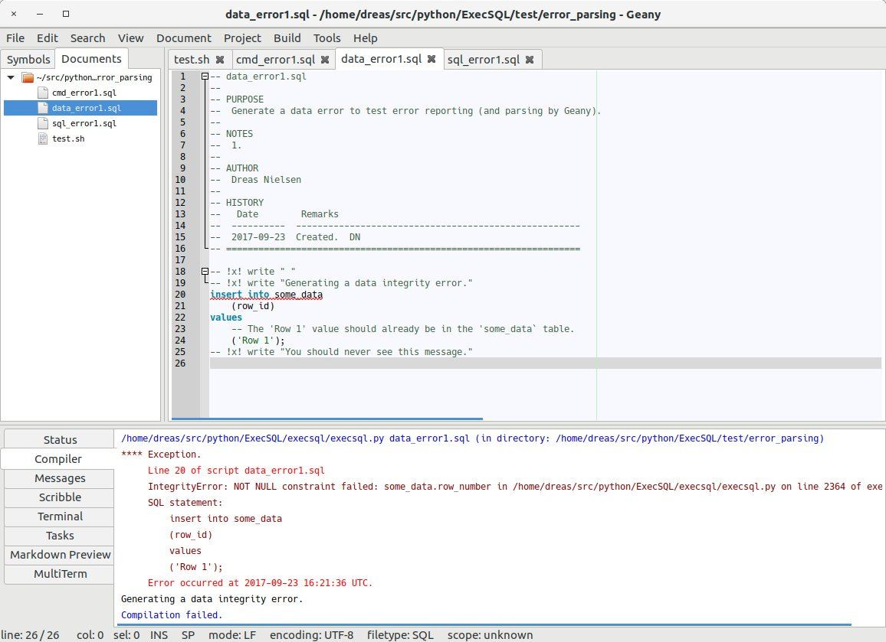
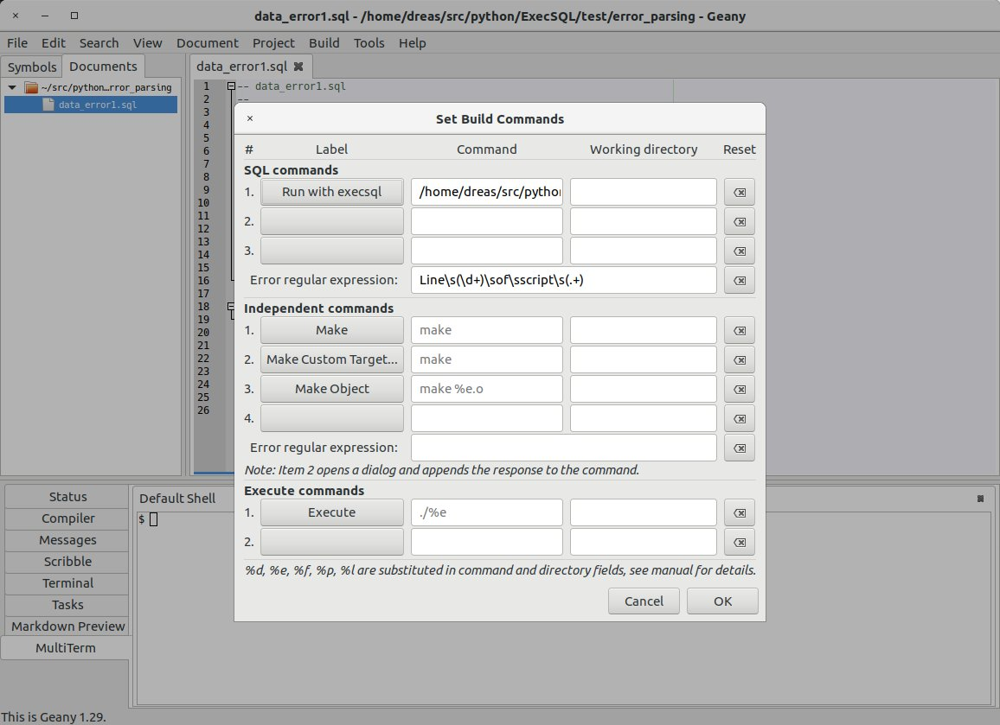
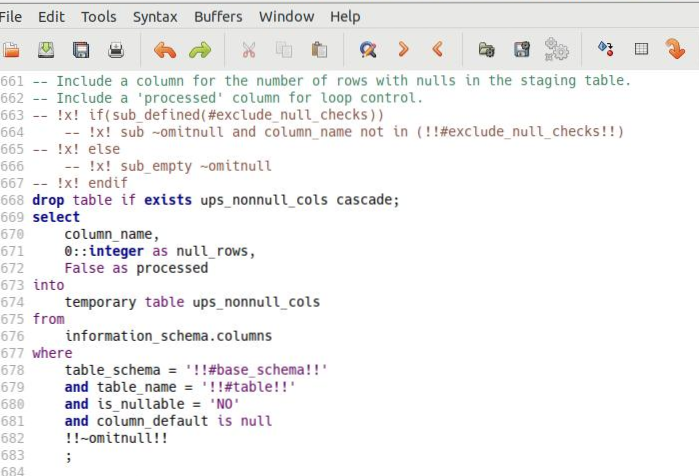

# Other editors

Install and [verify the language server](../editors.md#verify) first. Configure your editor to start `execsql lsp` for SQL files using standard input/output. Use the client configuration below as a starting point for the named client version.

## Neovim { #neovim }

Neovim 0.11 and later:

```lua
vim.lsp.config("execsql", {
  cmd = { "execsql", "lsp" },
  filetypes = { "sql" },
  root_markers = { "execsql.conf", ".git" },
})
vim.lsp.enable("execsql")
```

## Helix { #helix }

In `languages.toml`:

```toml
[language-server.execsql]
command = "execsql"
args = ["lsp"]

[[language]]
name = "sql"
language-servers = ["execsql"]
```

## Other editors { #other }

Any editor with a language server client can use it: configure a server for
the `sql` language whose command is `execsql lsp`, run over stdio. Sublime Text
(the LSP package), Emacs (eglot or lsp-mode), Zed and JetBrains IDEs (the LSP4IJ
plugin) all work this way.

## Geany and Vim

### Running Execsql From Within the Geany Editor

[Geany](http://www.geany.org/) can be used not only as an editor, but as an integrated development environment, and therefore contains features that allow code to be run from inside the editor, and error messages parsed so that lines containing errors can be highlighted in the editor.

These features can be used to run *execsql* from within the editor, and if an error occurs, have the error line highlighted so that a correction can be easily made. The result of this is illustrated in the following figure.



To enable this capability, use the *Build/Set Build Commands* menu item. A dialog box like that shown below will be displayed. This will allow you to create a new build command to run *execsql* on the script being edited. You should enter a label for this command (e.g., "Run with execsql"); the command to run, using *%f* as a placeholder for the name of the current script (e.g., "execsql run -v2 %f"); and the regular expression that Geany will use to extract the line number and file name out of *execsql's* error message--this should be "Line\\s(\\d+)\\sof\\sscript\\s(.+)".



After entering this information, a new item ("Run with execsql") will be available on Geany's Build menu. You can also invoke this command with the F8 key.

If *execsql* will be used with multiple databases, then connection parameters and other configuration information should be provided in a configuration file rather than on the command line. Some command-line options may be included on the default command line, as shown by the "-v2" option shown above. The "-v" option with a value of 1 or higher must be used when running *execsql* from within Geany because Geany captures console output and does not allow console input.

### Highlighting Execsql Metacommands in Vim

When using Vim, the standard syntax highlighting for SQL files can be extended with alternate highlighting for the comment lines that contain *execsql* metacommands. The extra syntax highlighting rules should be put in a file named "sql.vim" in the 'syntax' subdirectory of the 'after' directory; on Linux this is:

```
~/.vim/after/syntax/sql.vim
```

To find the 'after' directory on Windows, on the Vim command line, run:

```
echo &rtp
```

This will display Vim's runtime path, which should include an 'after' directory (which may not yet exist).

The lines to add to the "sql.vim" file are:

```
syntax match XSql "^\s*--\s*![xX]!.*$"
highlight XSql ctermfg=Brown guifg=#824E41
```

The first of these lines establishes a group name ("XSql") for metacommand lines, and the second applies a brown foreground (text) color in both the terminal and GUI versions of Vim. Of course, any other formatting could be applied instead of the colors shown above.

An illustration of custom highlighting for *execsql* metacommands is shown below.



The screenshot above uses the *ancient* colorscheme. The same color specification works well with the *desert-night* dark color scheme.

### Highlighting Execsql Metacommands in Bluefish

To add metacommand highlighting to Bluefish, edit `sql.bflang2` (`/usr/share/bluefish/bflang/` on Linux, or `share\bluefish\bflang\` under the install directory on Windows; copy to `~/.bluefish/` to override globally). In the `<header>` section, add:

```
<highlight name="execsql_metacommand" style="execsql_metacommand" />
```

Within `<context>`, add:

```
<group case_insens="1" highlight="execsql_metacommand">
    <element pattern="-- *!x![^&#10;&#13;]*" is_regex="1" />
</group>
```

Assign visual attributes for the `execsql_metacommand` style via *Edit / Preferences / Editor settings / Text styles* with a SQL file open.
