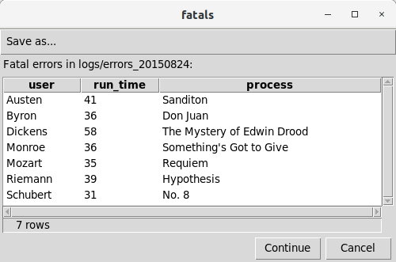

# Basics and variables

[All examples](../examples.md) · [First script](../../getting-started/first-script.md)

## Report fatal errors { #example1 }

**Illustrative PostgreSQL/GUI recipe.** Create the `staging` schema and supply the date-named error log with `user`, `run_time`, `process` and `severity` headers. Save as `fatal_errors.sql` and run against that database. It replaces/drops `staging.errorlog` and writes a dated CSV report; the input is not supplied here. For a complete local workflow start with [your first script](../../getting-started/first-script.md).

The following code illustrates the use of metacommands and substitution variables. Lines starting with "-- !x!" are metacommands that implement *execsql*-specific features. Identifiers enclosed in pairs of exclamation points (!!) are substitution variables that have been defined with the SUB metacommand. The "$date_tag" variable is a [substitution variable](../../reference/substitution_vars.md#substitution_vars) that is defined by *execsql* itself rather than by the user.

```sql
-- ==== Configuration ====
-- Put the (date-tagged) logfile name in the 'inputfile' substitution variable.
-- !x! SUB inputfile logs/errors_!!$date_tag!!
-- Ensure that the export directory will be created if necessary.
-- !x! CONFIG MAKE_EXPORT_DIRS Yes

-- ==== Display Fatal Errors ====
-- !x! IF(file_exists(!!inputfile!!))
    -- Import the data to a staging table.
    -- !x! IMPORT TO REPLACEMENT staging.errorlog FROM !!inputfile!!
    -- Create a view to display only fatal errors.
    create temporary view fatals as
        select user, run_time, process
        from   staging.errorlog
        where  severity = 'FATAL';
    -- !x! IF(HASROWS(fatals))
        -- Export the fatal errors to a dated report.
        -- !x! EXPORT fatals TO reports/error_report_!!$date_tag!! AS CSV
        -- Also display it to the user in a GUI.
        -- !x! PROMPT MESSAGE "Fatal errors in !!inputfile!!:" DISPLAY fatals
    -- !x! ELSE
        -- !x! WRITE "There are no fatal errors."
    -- !x! ENDIF
-- !x! ELSE
    -- !x! WRITE "There is no error log."
-- !x! ENDIF
drop table if exists staging.errorlog cascade;
```

The [IMPORT](../../reference/metacommands.md#import) metacommand reads the specified file of error messages and loads the data into the target (staging) table, automatically choosing appropriate data types for each column. The [EXPORT](../../reference/metacommands.md#export) metacommand saves the data in a CSV file that can be used by other applications. The [PROMPT](../../reference/metacommands.md#prompt) metacommand produces a GUI display of the data like the following:



## Include an optional QA file { #example5 }

**Runnable SQLite recipe.** Save both files in one directory. `optional.sql` creates a small fixture and conditionally includes its check:

```sql
-- optional.sql
create table bioaccum_samp (sample_id text);
insert into bioaccum_samp values ('S-1');
-- !x! IF (TABLE_EXISTS(bioaccum_samp))
    -- !x! INCLUDE check_optional.sql
-- !x! ENDIF
```

Save this companion as `check_optional.sql`:

```sql
-- !x! ASSERT HASROWS(bioaccum_samp) "Optional sample table is empty"
-- !x! WRITE "Optional sample check passed."
```

Run `execsql run -tl -n optional.sql optional.sqlite` in a fresh directory. It creates the database and sample table and prints `Optional sample check passed.`. In a real load, leave table creation to the optional load step; the check is skipped when the table is absent.

## Evaluate nested variable names { #example7 }

**Runnable SQLite recipe.** Save as `arguments.sql`. Each loop constructs the name of the next positional argument, then expands that name to obtain its value:

```sql
-- !x! SUB position 1
-- !x! SUB argument $ARG_!!position!!
-- !x! LOOP WHILE (SUB_DEFINED(!!argument!!))
    -- !x! WRITE "!!argument!! = !!!!argument!!!!"
    -- !x! SUB_ADD position 1
    -- !x! SUB argument $ARG_!!position!!
-- !x! END LOOP
```

```sh
execsql run --dsn sqlite:///:memory: -a one -a two arguments.sql
```

Expected output is `$ARG_1 = one` followed by `$ARG_2 = two`. `!!!!argument!!!!` first substitutes `argument` to produce `!!$ARG_1!!`, then substitutes the positional value. The explicit index advances once per iteration; it does not depend on how often a counter variable is read. No recursive file inclusion is needed.

## Store command-line text safely { #example9 }

**Runnable SQLite recipe.** Save as `add.sql`. This demonstration creates its table if needed; subsequent runs add another task.

```sql
create table if not exists todo (todo text, date_due text);
-- !x! IF (SUB_DEFINED($arg_1))
    -- !x! IF (SUB_DEFINED($arg_2))
        insert into todo (todo, date_due) values (!'!$arg_1!'!, !'!$arg_2!'!);
    -- !x! ELSE
        insert into todo (todo) values (!'!$arg_1!'!);
    -- !x! ENDIF
-- !x! ELSE
    -- !x! WRITE "Supply the task with -a."
-- !x! ENDIF
-- !x! EXPORT todo TO stdout AS CSV
```

```sh
execsql run -tl -n -a "Share O'Brien's food" -a 2026-11-21 add.sql todo.db
```

The stored task is exactly `Share O'Brien's food`. The `!'!name!'!` form produces a quoted SQL text literal, including its outer quotes. Do not add another pair of quotes. Raw `!!name!!` is appropriate for deliberate SQL fragments; it is not the form to use for user-entered text values. See [SQL quoting](../../reference/substitution_vars.md#substitution_vars).

Named variables use the same literal form: `--var task="Share O'Brien's food"` is referenced as `!'!task!'!`. Positional `-a` variables have the `$arg_` prefix.

## Evaluate an expression with SQL { #example16 }

**Runnable PostgreSQL expression example.** Save as `expression.sql` and run against PostgreSQL. It creates a temporary view and sets `sum` to `79`. `right()` and the cast use PostgreSQL syntax; this is not a SQLite example.

Although execsql does not itself process mathematical expressions or other similar operations on substitution variables, all of the functions of SQL and the underlying DBMS can be used to evaluate complex expressions that use substitution variables. For example:

```sql
-- !x! sub var1 56
-- !x! sub var2 October 23
create temporary view var_sum as
select cast(right(!'!var2!'!, 2) as integer) + !!var1!! as x;
-- !x! subdata sum var_sum
```

This will assign the result of the expression to the substitution variable "sum". Any mathematical, string, date, or other functions supported by the DBMS in use can be applied to substitution variables in this way.

## Populate outer-scope local variables { #example24 }

**Illustrative SQL Server fragment.** Requires matching `base`/`staging` schemas, `all_types` tables and primary-key metadata. Save the four blocks together in the displayed order. It creates temporary working objects and constructs comparison SQL; supply source data separately.

*Example contributed by E. Shea.*

This example illustrates use of the plus prefix in script arguments to access local substitution variables from an outer scope. The example constructs a SQL statement that compares two identically-structured tables by the same name in "base" and "staging" schemas. The SQL in this example is specific to MS SQL Server.

The example is separated into four code blocks: (1) data preparation and instantiation of local substitution variables; (2) "execute script" calls with plus-prefixed arguments to aggregate column names and create dynamic SQL; (3) use of the local substitution variables that were populated by the string aggregation script; and (4) definition of the string aggregation script.

The first block defines the tables' structure, populating a complete list of table columns and a second list of primary key columns, and instantiating the local substitution variables that will be used to build a SQL statement.

```sql
-- --------------------------------------------------------------------
-- 1) Data preparation and instantiation of local substitution variables
-- --------------------------------------------------------------------
-- Identify base and staging schemas and table
-- !x! sub base_schema dbo
-- !x! sub staging_schema staging
-- !x! sub table all_types

-- Get a list of columns in a table
if object_id('tempdb..#ups_cols') is not null drop table #ups_cols;
select column_name, ordinal_position
into #ups_cols
from information_schema.columns
where
    table_schema = !'!base_schema!'!
    and table_name = !'!table!'!
;

-- Get the names of the primary key columns of the table.
if object_id('tempdb..#ups_pks') is not null drop table #ups_pks;
select k.column_name, k.ordinal_position
into #ups_pks
from information_schema.table_constraints as tc
inner join information_schema.key_column_usage as k
    on tc.constraint_type = 'PRIMARY KEY'
    and tc.constraint_name = k.constraint_name
    and tc.constraint_catalog = k.constraint_catalog
    and tc.constraint_schema = k.constraint_schema
    and tc.table_schema = k.table_schema
    and tc.table_name = k.table_name
    and tc.constraint_name = k.constraint_name
where
    k.table_schema = !'!base_schema!'!
    and k.table_name = !'!table!'!
;

-- Get all "base table" columns with a "b." prefix for creation of
-- a comma-delimited list.
if object_id('tempdb..#ups_allbasecollist') is not null drop table #ups_allbasecollist;
select
    cast('b.' + column_name as varchar(max)) as column_list,
    ordinal_position
into #ups_allbasecollist
from #ups_cols;


-- Get all "staging table" column names with an "s." prefix for creation
-- of a comma-delimited list.
if object_id('tempdb..#ups_allstgcollist') is not null drop table #ups_allstgcollist;
select
    cast('s.' + column_name as varchar(max)) as column_list,
    ordinal_position
into #ups_allstgcollist
from #ups_cols;


-- Create a join expression for key columns of the base (b) and staging (s) tables.
if object_id('tempdb..#ups_joinexpr') is not null drop table #ups_joinexpr;
select
    cast('b.' + column_name + ' = s.' + column_name as varchar(max)) as column_list,
    ordinal_position
into #ups_joinexpr
from
    #ups_pks;
-- --------------------------------------------------------------------
-- --------------------------------------------------------------------
```

The second code block executes a script (defined below) that performs string aggregation on each of the column lists constructed in the previous block. In this block, local variables are instantiated as empty, and then are passed as plus-prefixed arguments in the "execute script" metacommand (the last argument passed to the script; the code block below needs to be scrolled to see these arguments). Each execution of the script assigns its output (an aggregated string) to the corresponding (tilde-prefixed) local variable in the outer scope. The "+" prefix used with the variable names in the script argument list gives the string aggregation script access to local variables that are defined in the outer scope.

```sql
-- --------------------------------------------------------------------
-- 2) "Execute script" calls with plus-prefixed arguments
-- --------------------------------------------------------------------

-- !x! sub_empty ~allbasecollist
-- !x! execute script string_agg with(table_name=#ups_allbasecollist, string_col=column_list, order_col=ordinal_position, delimiter=", ", string_var=+allbasecollist)

-- !x! sub_empty ~allstgcollist
-- !x! execute script string_agg with(table_name=#ups_allstgcollist, string_col=column_list, order_col=ordinal_position, delimiter=", ", string_var=+allstgcollist)

-- !x! sub_empty ~joinexpr
-- !x! execute script string_agg with(table_name=#ups_joinexpr, string_col=column_list, order_col=ordinal_position, delimiter=" and ", string_var=+joinexpr)
-- --------------------------------------------------------------------
-- --------------------------------------------------------------------
```

The third block uses the substitution variables populated in the previous step to construct SELECT statements showing columns with matching keys in base and staging tables.

```sql
-- --------------------------------------------------------------------
-- 3) Use of local substitution variables populated during script
--    execution
-- --------------------------------------------------------------------
-- Create a FROM clause for an inner join between base and staging
-- tables on the primary key column(s).
-- --------------------------------------------------------------------
-- !x! sub ~fromclause FROM !!base_schema!!.!!table!! as b INNER JOIN !!staging_schema!!.!!table!! as s ON !!~joinexpr!!

-- --------------------------------------------------------------------
-- Create SELECT queries to pull all columns with matching keys from both
-- base and staging tables.
-- --------------------------------------------------------------------
if object_id('tempdb..#ups_basematches') is not null drop table #ups_basematches;
select !!~allbasecollist!!
into #ups_basematches
!!~fromclause!!;


if object_id('tempdb..#ups_stgmatches') is not null drop table #ups_stgmatches;
select !!~allstgcollist!!
into #ups_stgmatches
!!~fromclause!!;
-- --------------------------------------------------------------------
-- --------------------------------------------------------------------
```

The fourth block is the definition of the 'string_agg' script. (Note: SQL Server versions 2017 and later include a "string_agg" function that serves the same purpose as this script; earlier versions of SQL Server do not include this function.)

```sql
-- --------------------------------------------------------------------
-- 4) Script definition
-- --------------------------------------------------------------------
-- !x! BEGIN SCRIPT STRING_AGG with parameters (table_name, string_col, order_col, delimiter, string_var)
if object_id('tempdb..#agg_string') is not null drop table #agg_string;
with enum as
    (
    select
        !!#string_col!! as agg_string,
        row_number() over (order by !!#order_col!!) as row_num
    from
        !!#table_name!!
    ),
agg as
    (
    select
        one.agg_string,
        one.row_num
    from
        enum as one
    where
        one.row_num=1
    UNION ALL
    select
        agg.agg_string + !'!#delimiter!'! + enum.agg_string as agg_string,
        enum.row_num
    from
        agg, enum
    where
        enum.row_num=agg.row_num+1
    )
select
agg_string
into #agg_string
from agg
where row_num=(select max(row_num) from agg);
-- !x! if(hasrows(#agg_string))
-- !x! subdata !!#string_var!! #agg_string
-- !x! endif

-- !x! END SCRIPT
-- --------------------------------------------------------------------
-- --------------------------------------------------------------------
```

## Run scripts from Python { #example42 }

The [complete Python API recipe](../../api/index.md#regional-summary) supplies an in-memory sales fixture, a parameterized SQL script and expected output. It shows connection ownership and error handling beside the canonical API contract.
