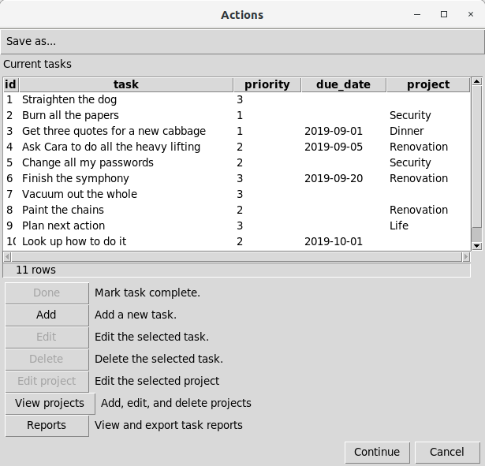
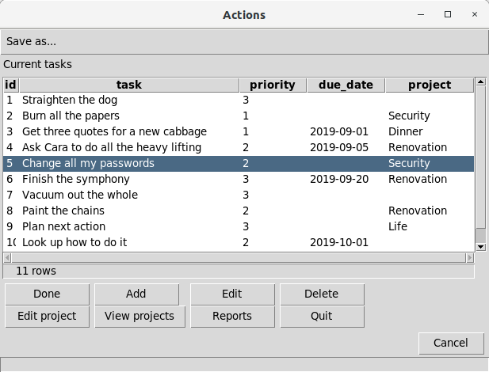
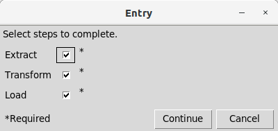

# Interactive tools and debugging

[All examples](../examples.md) · [First script](../../getting-started/first-script.md)

## Summarize data in Access { #example2 }

**Illustrative Access recipe.** Requires a configured Access connection, Windows/Access tooling, and all `dt_*`/`rt_*` source tables and fields used below. Save as `summarize.sql` and run against that database. It creates temporary query objects and selects a summary; it does not supply or load the source dataset.

This example illustrates a script that makes use of several temporary queries to select and summarize data, and a final query that prepares the data for export or further use. The SQL in this example is specific to MS-Access.

```sql
-- --------------------------------------------------------------------
-- Get result records that meet specific selection criteria.
-- --------------------------------------------------------------------
create temporary view v_seldata as
select
  smp.sys_sample_code, rs.test_surrogate_key,
  rs.cas_rn, tst.lab_anl_method_name,
  if(rs.detect_flag='N', rs.method_detection_limit, rs.result_value) as conc,
  rs.detect_flag='Y' as detected,
  rs.lab_qualifiers like '*J*' as estimated,
  if(rs.detect_flag='N', rs.detection_limit_unit, rs.result_unit) as unit
from
  ((((dt_result as rs
  inner join dt_test as tst on tst.test_surrogate_key=rs.test_surrogate_key)
  inner join dt_sample as smp on smp.sys_sample_code=tst.sys_sample_code)
  inner join dt_field_sample as fs on fs.sys_sample_code=smp.sys_sample_code)
  inner join dt_location as loc on loc.sys_loc_code=fs.sys_loc_code)
  inner join rt_analyte as anal on anal.cas_rn=rs.cas_rn
where
  (loc.loc_name like 'SG*' or loc.loc_name like 'SC*')
  and smp.sample_type_code='N'
  and smp.sample_matrix_code='SE'
  and anal.analyte_type in ('ABN', 'PEST', 'PCB', 'LPAH', 'HPAH')
  and rs.reportable_result='Yes'
  and not (rs.result_value is null and rs.method_detection_limit is null);

-- --------------------------------------------------------------------
-- Summarize by sample, taking nondetects at half the detection limit.
-- --------------------------------------------------------------------
create temporary view v_samp as
select
  sys_sample_code, cas_rn, lab_anl_method_name,
  Avg(if(detected, conc, conc/2.0)) as concentration,
  Max(if(detected is null, 0, detected)) as detect,
  Min(if(estimated is null, 0, estimated)) as estimate,
  unit
from
  v_seldata
group by
  sys_sample_code, cas_rn, lab_anl_method_name, unit;

-- --------------------------------------------------------------------
-- Pull in sample location and date information, decode analyte,
-- and reconstruct qualifiers.
-- --------------------------------------------------------------------
select
  loc.loc_name, fs.sample_date, fs.start_depth, fs.end_depth, fs.depth_unit,
  smp.sample_name, anal.chemical_name, dat.lab_anl_method_name,
  concentration as conc,
  (if(detect, "", "U") & if(estimate, "J", "")) as qualifiers,
  unit
from
  (((v_samp as dat
  inner join dt_sample as smp on dat.sys_sample_code=smp.sys_sample_code)
  inner join dt_field_sample as fs on fs.sys_sample_code=smp.sys_sample_code)
  inner join dt_location as loc on loc.sys_loc_code=fs.sys_loc_code)
  inner join rt_analyte as anal on anal.cas_rn=dat.cas_rn;
```

During the execution of this script with Access, the temporary queries will be created in the database. When the script concludes, the temporary queries will be removed. Nothing except the data itself need be kept in the database to use a script like this one.

## Inspect details of QA failures { #example17 }

**Illustrative PostgreSQL/GUI recipe.** Supply the populated `qa_results` table and the views named in its `detail_view` column. Save the main block and `qa_detail.sql` as separate files in one directory. The empty table declaration below describes the required input; it does not populate QA failures.

A set of QA checks performed on data may be summarized as a list of all of the checks that failed; however, there may also be detailed information about those results that the user would like to see---such as a list of all the data rows that failed. Assuming that a view has been created for each QA check, and that the QA check failures have been compiled into a table of this form (see also [Example 3](data-movement.md#example3)):

```sql
create table qa_results (
    description character varying(80),
    detail_view character varying(24)
    );
```

The detail_view column should contain the name of the view with detailed information about the QA failure. Both the summary and detailed information can be presented to the viewer using the following statements in the main script:

```sql
-- !x! if(hasrows(qa_results))
    -- !x! sub prompt_msg Select an item to view details, Cancel to quit data loading.
    -- !x! include qa_detail.sql
-- !x! endif
```

Save the next block as `qa_detail.sql`. It is included once; its LOOP repeats the dialog. PROMPT SELECT_SUB clears its previous column variables before each prompt, so Continue leaves no selected detail view:

```sql
-- !x! LOOP WHILE (TRUE)
-- !x! prompt select_sub qa_results message "!!prompt_msg!!" continue
-- !x! if(sub_defined(@detail_view))
    -- !x! prompt message "!!@description!!" display !!@detail_view!!
-- !x! else
    -- !x! BREAK
-- !x! endif
-- !x! END LOOP
```

The user can cancel further script processing using the "Cancel" button on either the summary dialog box or any of the detail displays. If the "Continue" button is chosen on the summary dialog box, script processing will resume.

## Convert units with an entry form { #example18 }

**Illustrative PostgreSQL/GUI recipe.** Requires the unit dictionary described below and both named files in one directory. Run `unit_conv.sql` against that database; it creates temporary form objects. Cancel stops the run under the default cancel policy.

This example illustrates the creation of a simple data entry form using the [PROMPT ENTRY_FORM](../../reference/metacommands.md#prompt_entry) metacommand. In this example, the form is used to get a numeric value and a recognized set of units for that value, and then display that value converted to all compatible units in the database.

This example relies on the presence of a unit dictionary in the database (`e_unit`) that contains the unit code, the dimension of that unit, and a conversion factor to convert values to a standard unit for the dimension. This example uses two scripts, named unit_conv.sql and unit_conv2.sql, the first of which [INCLUDEEs](../../reference/metacommands.md#include) the second.

`unit_conv.sql` :

```sql
create temporary table inp_spec (
    sub_var text,
    prompt text,
    required boolean,
    initial_value text,
    width integer,
    lookup_table text,
    validation_regex text,
    validation_key_regex text,
    sequence integer
    );

insert into inp_spec
    (sub_var, prompt, required, width, lookup_table, validation_regex, validation_key_regex, sequence)
values
    ('value', 'Numeric value', True, 12, null, '-?[0-9]+\\.?[0-9]*', '-?[0-9]?\\.?[0-9]*', 1),
    ('unit', 'Unit', True, null, 'e_unit', null, null, 2),
    ('comment', 'Comment', False, 40, null, null, null, 3)
    ;

create or replace temporary view entries as
select * from inp_spec order by sequence;

-- !x! prompt entry_form entries message "Enter a value, unit, and comment."

-- !x! include unit_conv2.sql
```

Note that to include a decimal point in the regular expressions for the numeric value, the regular expression needs a backslash before the decimal point. SQL backslash handling depends on the DBMS and string-literal mode; adjust these PostgreSQL expressions to the connection’s string settings rather than assuming the same escaping on every backend. Also note that in this case, the validation_regex and the validation_key_regex are identical except that all subexpressions in the latter are optional. If the first digit character class were not optional, then at least one digit would always be required, and entry of a leading negative sign would not be possible (though a negative sign could be added after at least one digit was entered).

`unit_conv2.sql` :

```sql
-- !x! LOOP WHILE (TRUE)
create or replace temporary view conversions as
select
    !!value!! * su.factor / du.factor as converted_value,
    du.unit
from
    e_unit as su
    inner join e_unit as du on du.dimension=su.dimension and du.unit <> su.unit
where
    su.unit=!'!unit!'!
order by
    du.unit;

update inp_spec
set initial_value=!'!value!'!
where sub_var = 'value';
-- !x! sub old_value !!value!!

update inp_spec
set initial_value=!'!unit!'!
where sub_var = 'unit';
-- !x! sub old_unit !!unit!!

-- !x! if(sub_defined(comment))
update inp_spec
set initial_value=!'!comment!'!
where sub_var = 'comment';
-- !x! endif

-- !x! prompt entry_form entries message "The conversions for !!value!! !!unit!! are:" display conversions

-- !x! IF (EQUAL("!!unit!!", "!!old_unit!!"))
-- !x! ANDIF (EQUAL("!!value!!", "!!old_value!!"))
    -- !x! BREAK
-- !x! ENDIF
-- !x! END LOOP
```

The unit_conv2.sql script will continue to display conversions for as long as either the value or the unit is changed.

## Validate a pair of form entries { #example23 }

*Example contributed by E. Shea; revised to use an iterative prompt.*

**Illustrative PostgreSQL/GUI recipe.** Save as `date_range.sql`; run against a disposable PostgreSQL database. It creates temporary form and validation tables. The loop ends only when both entries parse as dates and the end is not earlier than the start. Cancel stops the script with the default cancel policy.

```sql
create temporary table date_specs (
    sub_var text, prompt text, required boolean, sequence integer
);
insert into date_specs values
    ('min_date', 'Start date (YYYY-MM-DD)', true, 1),
    ('max_date', 'End date (YYYY-MM-DD)', true, 2);

create temporary table date_values (start_date date, end_date date);
-- !x! SUB date_message Enter the date range.
-- !x! LOOP WHILE (TRUE)
    -- !x! PROMPT ENTRY_FORM date_specs MESSAGE "!!date_message!!"
    delete from date_values;
    -- !x! ERROR_HALT OFF
    insert into date_values values (cast(!'!min_date!'! as date), cast(!'!max_date!'! as date));
    -- !x! ERROR_HALT ON
    -- !x! IF (SQL_ERROR())
        -- !x! SUB date_message Both values must be valid dates; try again.
    -- !x! ELSE
        create or replace temporary view reversed_dates as
        select 1 from date_values where start_date > end_date;
        -- !x! IF (HASROWS(reversed_dates))
            -- !x! SUB date_message The end date must not precede the start date.
        -- !x! ELSE
            -- !x! BREAK
        -- !x! ENDIF
    -- !x! ENDIF
-- !x! END LOOP
-- !x! PROMPT MESSAGE "Validated date range" DISPLAY date_values
```

The temporary error policy applies only to the conversion statement; it restores `ERROR_HALT ON` immediately afterward. Keep this validation outside an open batch: a failed statement marks every enclosing batch failed even when its error is handled. A library called under a different error policy should restore that caller's policy instead.

## Build an interactive task list { #example27 }

**Illustrative PostgreSQL/GUI application fragment.** Requires a task table and the callback scripts named by the action definitions. The omitted callbacks must be supplied before running this application. Their contents determine persistent edits; the dialog code alone is not a complete task application.

This example illustrates the creation of a simple interface that allows interactive editing of data in a table. For this example, the table (named "tasks") is a list of tasks to be completed, including priorities and due dates.

The specification table is created and populated as follows:

```sql
create temporary table action_list (
    label text not null,
    prompt text not null,
    script text not null,
    data_required boolean not null default True,
    sequence integer not null
);

insert into action_list
    (label, prompt, script, data_required, sequence)
values
    ('Done', 'Mark task complete.', 'task_done', True, 1),
    ('Add', 'Add a new task.', 'task_new', False, 2),
    ('Edit', 'Edit the selected task.', 'task_edit', True, 3),
    ('Delete', 'Delete the selected task.', 'task_delete', True, 4),
    ('Edit project', 'Edit the selected project', 'proj_edit', True, 5),
    ('View projects', 'Add, edit, and delete projects', 'proj_all', False, 6),
    ('Reports', 'View and export task reports', 'task_reports', False, 7)
    ;
```

The definitions of the scripts ('task_done', 'task_new', etc.) are not shown here.

The metacommand to display the user interface that combines this specification table with the list of tasks is:

```sql
-- !x! prompt action action_list message "Current tasks" display tasks continue
```

The user interface dialog that results appears as follows before any task is selected:



After a task is selected, all of the buttons will be enabled.

After any button is clicked, and the associated script is run, the PROMPT ACTION dialog box will be closed. To have the dialog box automatically re-displayed after a button is clicked, it should be invoked within a loop or recursive script, and the repetition controlled by a flag, as shown below. In this example, the existence of a substitution variable named "tasks_quit" is used as a flag.

Add a custom button to quit the PROMPT ACTION dialog box. This will be used instead of the 'Continue' button.:

```sql
insert into action_list
    (label, prompt, script, data_required, sequence)
values
    ('Quit', 'Quit editing tasks', 'tasks_quit', False, 8);

-- !x! begin script tasks_quit
    -- !x! sub tasks_quit Done
-- !x! end script
```

The value assigned to the "tasks_quit" variable does not matter; the assignment only serves to ensure that the variable exists.

Ensure that the flag variable is not defined, and then run the PROMPT ACTION metacommand until the variable is defined:

```sql
-- !x! rm_sub tasks_quit
-- !x! loop until (sub_defined(tasks_quit))
    -- !x! prompt action action_list message "Current tasks" display tasks compact 4
-- !x! end loop
```

The resulting dialog will look like this, with an item selected:



## Build a checkbox prompt { #example30 }

**Illustrative PostgreSQL/GUI recipe.** Save the named script and its invocation together. It builds temporary form specifications and sets the selected substitution variables. Supply the option/prompt pairs at the call site; the example uses PostgreSQL string/regular-expression functions.

A SQL script may have several sections, each of which can be run separately, and it may be useful to choose which sections to run each time the script is run. A set of checkboxes created with a [PROMPT ENTRY_FORM](../../reference/metacommands.md#prompt_entry) metacommand is a convenient way to interactively select which sections to run. If this technique is used repeatedly, the work to create the specification table for the entry form can be delegated to the following [SCRIPT](../../reference/metacommands.md#beginscript).

This script takes two arguments:

- **msg** : The message to be displayed above the checkboxes.
- **varprompts** : A string containing a semicolo-delimited list of comma-delimited pairs of substitution variable names and prompt text.

The script prepares a specification table for the PROMPT ENTRY_FORM metacommand, then runs that metacommand. The substitution variables that are named in the **varprompts** argument are set to 1 (True) or 0 (False) in response to the user's selections. This code is for Postgres.

```sql
-- !x! begin script prompt_checkboxes with parameters (msg, varprompts)

drop table if exists prck_specs cascade;
create temporary table prck_specs as
select
    ar[1] as sub_var,
    ar[2] as prompt,
    True as required,
    True as initial_value,
    'checkbox' as entry_type
from
    (
    select regexp_split_to_array(item, E'\\s*,\\s*') as ar
    from
        (
        select regexp_split_to_table(!'!#varprompts!'!, E'\\s*;\\s*') as item
        ) as itemlist
    ) as arraylist;

-- !x! prompt entry_form prck_specs message "!!#msg!!"

-- !x! end script prompt_checkboxes
```

This script can be run--the checkbox form created and displayed--with a single metacommand line like:

```sql
-- !x! execute script prompt_checkboxes(msg="Select steps to complete.", varprompts="extract,Extract;transform,Transform;load,Load")
```

This will produce the following entry form:



Instead of using a long string of variable names and prompts directly in the EXECUTE SCRIPT metacommand, the string could be created in a substitution variable with a series of [SUB](../../reference/metacommands.md#subcmd) and [SUB_APPEND](../../reference/metacommands.md#sub_append) metacommands.

## Enter SQL interactively { #example32 }

**Illustrative PostgreSQL/GUI application.** Supply a trusted database connection and install `formats` for the ODS option. The two alternative forms execute SQL entered by the user with that connection’s privileges; they are not a read-only query sandbox. They replace their working objects and output files.

Although execsql is designed to execute SQL scripts, its features can also be used to create simple interfaces to allow interactive querying. Two different approaches are illustrated in the following code snippets.

An interactive querying tool like these may be embedded into an error-handling script (e.g., one implemented with [ON ERROR_HALT EXECUTE SCRIPT](../../reference/metacommands.md#error_halt_exec)) to assist in interrogating temporary tables or views before they are automatically removed when the script finishes.

### a) Using PROMPT ENTER_SUB

This approach repeatedly displays a single-line entry area in which a SQL statement can be entered, then displays a view that results from executing that statement, with a prompt for an additional statement.

```sql
-- !x! sub msg !!$current_database!!
-- !x! sub_append msg Enter the SQL to execute.

-- !x! cancel_halt off
-- !x! prompt enter_sub sql_stmt message "!!msg!!"
-- !x! loop while (not dialog_canceled())
    drop view if exists sql_result cascade;
    create temporary view sql_result as !!sql_stmt!!;
    -- !x! sub msg !!$current_database!!
    -- !x! sub_append msg Previous SQL: !!sql_stmt!!
    -- !x! sub_append msg Enter the SQL to execute.
    -- !x! prompt enter_sub sql_stmt message "!!msg!!" display sql_result
-- !x! end loop
```

### b) Using PROMPT ENTRY_FORM

This approach is similar to the first one, but uses the [PROMPT ENTRY_FORM](../../reference/metacommands.md#prompt_entry) metacommand to present a multi-line entry area for the SQL statement, and also to prompt for a description of the query. In addition, each SQL statement and its description are saved to a SQL script file (*sql_statements.sql*), and the output of each statement is not only displayed on the screen but is also saved to an ODS workbook (*sql_output.ods*).

```sql
create temporary table get_sql (
    sub_var text,
    prompt text,
    required boolean default True,
    initial_value text,
    width integer,
    entry_type text,
    sequence integer
);

insert into get_sql
    (sub_var, prompt, entry_type, width, sequence)
values
    ('description', 'Query description', null, 50, 1),
    ('sql_stmt', 'Query SQL', 'textarea', 50, 2);


-- !x! sub msg !!$current_database!!

-- !x! rm_file sql_statements.sql
-- !x! rm_file sql_output.ods

-- !x! cancel_halt off
-- !x! prompt entry_form get_sql message "!!msg!!"
-- !x! loop while (not dialog_canceled())
    -- !x! sub stmt_no !!$counter_1!!
    -- !x! sub query_name query_!!stmt_no!!
    drop view if exists !!query_name!! cascade;
    create temporary view !!query_name!! as !!sql_stmt!!;
    -- !x! write "-- Query !!stmt_no!!" to sql_statements.sql
    -- !x! write "-- !!description!!" to sql_statements.sql
    -- !x! write `!!sql_stmt!!` to sql_statements.sql
    -- !x! write "" to sql_statements.sql
    -- !x! export !!query_name!! append to sql_output.ods as ods description "!!description!!"
    update get_sql
    set initial_value = !'!sql_stmt!'!
    where sub_var = 'sql_stmt';
    -- !x! prompt entry_form get_sql message "!!msg!!" display !!query_name!!
-- !x! end loop
```

## Inspect and export a fixed batch { #example36 }

**Runnable SQLite debugging demonstration.** Save as `debug_orders.sql`. It supplies three orders, writes `reports/processed.csv`, and replaces that report on every run. Run `execsql run --dsn sqlite:///:memory: debug_orders.sql` in a fresh directory.

```sql
create table orders (order_id integer primary key, processed boolean);
insert into orders values (1, false), (2, false), (3, false);
-- !x! CONFIG MAKE_EXPORT_DIRS YES
-- !x! SUB batch_size 2
-- !x! EXPORT QUERY <<select order_id, processed from orders where 1=0;>> TO reports/processed.csv AS CSV

create temporary view pending as
select order_id from orders where processed = false order by order_id limit !!batch_size!!;

-- !x! BREAKPOINT
-- !x! LOOP WHILE (HASROWS(pending))
    create temporary table current_batch as select order_id from pending;
    update orders set processed = true
    where order_id in (select order_id from current_batch);
    -- !x! EXPORT QUERY <<select o.order_id, o.processed from orders o join current_batch b on b.order_id=o.order_id order by o.order_id;>> APPEND TO reports/processed.csv AS CSV
    drop table current_batch;
-- !x! END LOOP
```

Expected CSV:

```csv
order_id,processed
1,1
2,1
3,1
```

`pending` is a live view: updating `orders` changes which rows it selects. `current_batch` freezes the IDs before the update, so the export reports exactly those orders with their new state. The final one-row batch is included. An interrupted or failed export is still an error to handle; this demonstration does not claim atomic file/database output.

[BREAKPOINT](../../reference/metacommands.md#breakpoint) opens a REPL on an interactive terminal. In CI or piped input it is skipped. At the prompt use `.vars` to inspect variables, `.next` to step, `.continue` to resume, `.where` for location, `.stack` for script frames, `.abort` to stop or `.help` for all commands. SQL ending in `;` runs against the active database. See [Debugging](../debugging.md) for the complete command reference.

For step-through execution from the beginning, run `execsql run --debug --dsn sqlite:///:memory: debug_orders.sql`.

## Find variable mistakes with lint { #example37 }

**Runnable lint demonstration; intentional warnings.** Save the first SQL block as `validate_orders.sql` and run the lint command shown. No database is used. The SQL references external PostgreSQL objects only to demonstrate analysis; do not execute it as a load.

`execsql lint` parses scripts and checks them without connecting to a database or executing anything, so it is safe to run in CI. It reports errors (unmatched `IF`/`ENDIF`, `LOOP`/`END LOOP`, `BEGIN BATCH`/`END BATCH`; a metacommand or condition *execsql* does not recognize; a dollar-quoted body that would be split) and warnings: variables that are used but never defined, variables that are defined but never used, `IF` conditions that are always true or always false, statements after an unconditional `HALT`, missing `INCLUDE` files, and empty scripts.

Consider a script with a typo: the export path is defined as `report_dir` but referenced as `!!output_path!!`.

```sql
-- validate_orders.sql
-- !x! SUB report_dir /tmp/reports

create temporary view stale_orders as
    select order_id, created_at
    from orders
    where created_at < current_date - interval '90 days';

-- !x! IF(HASROWS(stale_orders))
    -- !x! EXPORT stale_orders TO !!output_path!!/stale.csv AS CSV
-- !x! ENDIF
```

Running the linter:

```bash
execsql lint validate_orders.sql
```

Produces output similar to:

```text
validate_orders.sql
   2  warning  V002  variable !!report_dir!! is never used
  10  warning  V001  undefined variable !!output_path!!

Found 2 issues in 1 file: 2 warnings (1 file checked)
```

The two warnings are the two halves of the same typo: one name is defined and never read, the other is read and never defined. `V001` and `V002` are [rule codes](../../reference/lint.md#rules); a library that sets variables in a configuration file can drop the undefined-variable check with `execsql lint scripts/ --ignore V001`.

Errors appear as `ERROR` and make `execsql lint` exit with code 1. Warnings alone exit with code 0, so a CI step gated on `execsql lint` fails only on a structural error. Pass a directory to check every `*.sql` file under it:

```bash
execsql lint scripts/
```

The linter performs a two-pass analysis: it first collects all variable definitions across the entire script (including `BEGIN SCRIPT` blocks), then checks all references. This means a variable defined after its first use is not flagged as undefined.

## Preview the script parse tree { #example38 }

**Parse-only illustration.** The SQL below assumes PostgreSQL tables and uses independent unordered selections; do not execute it as a production move/delete workflow. For execution, freeze a common key set first as in [the batching recipe](interactive.md#example36).

The `--parse-tree` flag parses a script into an abstract syntax tree and prints the tree structure. No database connection is required. Use it to understand how execsql has parsed a script, diagnose conditional nesting, or verify that complex loop and branch structures are interpreted as intended.

Consider a script with nested `IF` and `LOOP` blocks:

```sql
-- pipeline.sql
-- !x! SUB batch_size 1000

-- !x! IF(TABLE_EXISTS(staging.raw))
    -- !x! LOOP WHILE (HASROWS(staging.raw))
        insert into production.data
            select * from staging.raw limit !!batch_size!!;

        delete from staging.raw
        where ctid in (
            select ctid from staging.raw limit !!batch_size!!
        );
    -- !x! END LOOP
-- !x! ELSE
    -- !x! WRITE "Staging table does not exist. Skipping load."
-- !x! ENDIF
```

Running:

```bash
execsql run --parse-tree pipeline.sql
```

Prints a tree like:

```text
Script: pipeline.sql (2 nodes)
├── [1] <CMD> SUB batch_size 1000
└── [3-12] <IF> IF (TABLE_EXISTS(staging.raw))
    ├── [4-10] <LOOP> WHILE (HASROWS(staging.raw))
    │   ├── [5-7] <SQL> insert into production.data ...
    │   └── [9-11] <SQL> delete from staging.raw ...
    [12]ELSE
    └── [13] <CMD> WRITE "Staging table does not exist. Skipping load."
```

Each node is labeled with its line number (or range), a type tag (`<SQL>`, `<CMD>`, `<IF>`, `<LOOP>`, `<BATCH>`, `<SCRIPT>`, `<INC>`, `<CMT>`), and a preview of the content. Block nodes nest their children underneath with tree-drawing connectors.

## Profile script execution { #example39 }

**CLI-output illustration.** Supply your own `etl_pipeline.sql` and connection configuration before running the profile command. The sample timings describe output shape, not expected performance on your machine.

The `--profile` flag records per-statement execution time and prints a timing summary after the script completes. Use it to find the statements that consume the most wall-clock time in a long-running ETL script.

```bash
execsql run --profile --profile-limit 10 etl_pipeline.sql myserver mydb
```

After the script finishes, execsql prints a table sorted by elapsed time, showing the top statements by duration:

```text
Profile: 47 statements in 12.841s

  Time (s)    Pct      Source:Line           Type     Command
  ----------  -------  --------------------  -------  ----------------------------------------
  4.203       32.7%    etl_pipeline.sql:88   SQL      insert into production.fact select ...
  3.118       24.3%    etl_pipeline.sql:42   SQL      create index idx_orders_date on orders...
  1.847       14.4%    etl_pipeline.sql:61   SQL      update production.dim_customer set ...
  0.934        7.3%    etl_pipeline.sql:29   SQL      delete from staging.temp where ...
  0.701        5.5%    etl_pipeline.sql:17   METACMD  IMPORT TO REPLACEMENT staging.raw ...
  ...
```

Each row shows:

- **Time (s)** — elapsed seconds for that statement
- **Pct** — percentage of total script wall time
- **Source:Line** — script file and line number
- **Type** — `SQL` for SQL statements, `METACMD` for metacommands
- **Command** — a preview of the statement text (truncated at 50 characters)

`--profile-limit N` controls how many rows appear in the table (default: 20). All statements contribute to the totals regardless of the limit. Combine `--profile` with `--profile-limit 0` to see every statement.

The `--profile` flag has no effect on `--dry-run`, which executes no statements.
